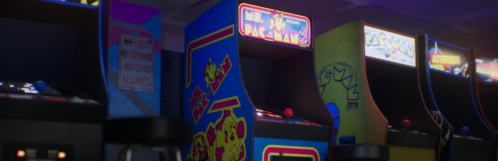

	
	

		Jeu complet
		<h3>Ms. Pac-Man</h3>
		
La version arcade sur TO8, à 30 images/s, avec un pilote automatique par réseau de neurones. Le premier jeu complet signé wide-dot.

		

			<a href="ms-pacman.html" class="button primary">La fiche du jeu</a>
			<a href="/toje/?media=%2Freleases%2Fms-pacman%2Fms-pacman.fd&amp;titre=Ms.+Pac-Man" class="button">Jouer dans le navigateur</a>
		

	

Notre groupe travaille actuellement sur 3 projets majeurs de jeux pour Thomson TO8 et TO9+ :

- la conversion/adaptation de [R-Type](/r-type.html), par reverse-engineering de la version arcade de IREM,
- l'adaptation du célèbre [Battle Squadron](https://www.youtube.com/watch?v=P2Igl7zKvjM), inspiré du jeu d'origine sur Amiga,
- la création d'un jeu original, [Goldorak](/goldorak.html), fondé sur le [projet initial Amstrad GX4000](https://amigamuseum.emu-france.info/Fichiers/sites/Goldorak_CPC/Goldorak_CPC.html).

Nos développements sont réalisés en <b>Assembleur 6809</b> (LWASM sur Windows, Linux et MacOS) conjointement avec de l'outillage spécifique réalisé essentiellement en Java. Ces projets s'appuient sur un moteur de jeu (sprites, scrollings, musiques, etc.) réalisé <b>100% en Assembleur 6809</b>.

L'ensemble de nos réalisations, développements en cours ou démos techniques :

<b>Projets de jeux</b>



<b>Démos techniques</b>



