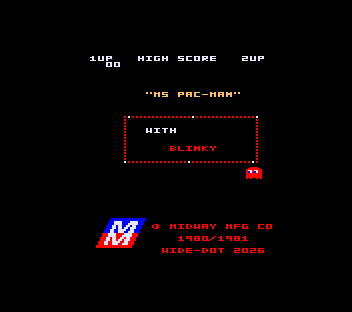
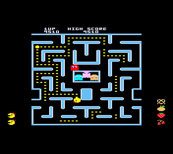

## Description

Ms. Pac-Man, la vraie, celle de la borne, tourne sur TO8.

On a repris le code Z80 de l'arcade et on l'a réécrit en 6809, routine par routine. Puis on a fait tourner MAME à côté, frame par frame, jusqu'à ce que tout colle. Les fantômes ont leur vraie IA, les fruits leurs vrais trajets, et ça va jusqu'au tableau 142… là où la borne plante. Le TO8 plante aussi, pareil.

Pour les graphismes, on a pris ceux de la version Atari 7800 : 160 pixels de large, pile la largeur du mode 16 couleurs du TO8. Le son, c'est le driver de la borne, sur une carte SN76489.

La borne tourne à 60 Hz, le TO8 à 50. Pour garder la bonne vitesse, on fait 6 frames arcade pour 5 frames TO8.

    
    

## Jouer

Fire pour mettre une pièce, fire pour lancer la partie.

Pas de son ? Une touche du clavier change le port de la carte son (affiché en haut à droite). Le choix est validé au bout de 2 secondes.

## Le bonus

Haut, bas, gauche, droite, fire… et Ms. Pac-Man joue toute seule, vies infinies.

Aux commandes, un petit réseau de neurones. Entraîné en C dans un simulateur de la borne, puis porté en 6809. 7,7 ms par décision en moyenne, à peine plus d'une vie perdue par niveau. Même combinaison pour reprendre la main.

Pas de TO8 sous la main ? Ça tourne aussi [dans le navigateur](/toje/?jeu=ms-pacman.fd) avec TOJE.

*Aucune exploitation commerciale n'est autorisée.*

---

Credit spécial pour Cameron Hickling et sa superbe salle d'arcade :
<https://www.artstation.com/artwork/GvXlk1>


