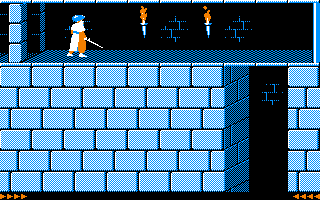

## Description

Prince of Persia arrive sur TO8 !

On est parti du code source Apple II de Jordan Mechner : chaque routine 6502 est portée en 6809, puis comparée au cycle près au jeu Apple II qui tourne sous MAME. Les sauts, les chutes et les combats sont ceux de 1989, au même rythme.

L'image reprend les dessins de la version PC en CGA, en 320x200 et 4 couleurs, avec les couleurs de l'Apple : noir, bleu, orange et blanc. Le son passe par le CNA du TO8, pas besoin de carte son.

## Les outils de Mechner

En bonus, on a porté l'éditeur de niveaux que Mechner utilisait pour construire son jeu. Il tient sur deux disquettes, une pour le donjon et une pour le palais, avec leurs disquettes de données (dans le ZIP).

Ses touches de développement sont aussi dans le jeu, endormies : tapez P O P pendant une partie pour les réveiller.

## Jouer

Le jeu se joue au clavier, avec les touches de l'Apple II : J et L pour courir, I pour sauter ou grimper, K pour se baisser, U et O pour sauter en avant, Espace pour l'épée.
La manette marche en même temps que le clavier, pad Mega Drive compris.

CNT-G sauvegarde la partie à partir du niveau 3, sur une disquette non protégée. CNT-L sur l'écran titre la reprend.

C'est une version de test : vos retours sur vrai TO8 nous intéressent.

Pas de TO8 sous la main ? Ça tourne aussi [dans le navigateur](/toje/?media=%2Freleases%2Fprince-of-persia%2Fprince-of-persia.fd&titre=Prince+of+Persia) avec TOJE.

***Aucune exploitation commerciale n'est autorisée.***

    
    
    

---

Credit spécial pour Jordan Mechner et ses planches de rotoscopie « Run-Jump » en banner :
<https://www.jordanmechner.com/en/artworks/run-jump/>


