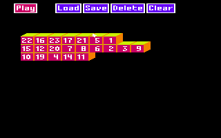

## Description

Prince of Persia enfin sur TO8 !

Le [code 6502 de Jordan Mechner](https://github.com/jmechner/Prince-of-Persia-Apple-II) a été porté routine par routine en 6809, et comparé a l'exécution à la version Apple II. Les graphismes viennent de la version PC en 4 couleurs, le son passe par le CNA du TO8.

## Jouer

Le jeu se joue au clavier :
{: style="margin-bottom: 0"}

- **J / L** : courir
- **I** : sauter
- **K** : se baisser
- **U / O** : sauter en avant
- **Espace** : l'épée
- **Maj + J / L** : avancer prudemment
{: style="margin-bottom: 0"}

La manette marche aussi, pad Mega Drive compris. 
Toutes les commandes, celles du jeu, du développement et de l'éditeur, sont [plus bas](#commandes).

Pas de TO8 sous la main ? Ça tourne aussi [dans le navigateur](/toje/?media=%2Freleases%2Fprince-of-persia%2Fprince-of-persia.fd&titre=Prince+of+Persia) avec TOJE.

***Aucune exploitation commerciale n'est autorisée.***

    
    

 

## L'éditeur de Jordan Mechner

En bonus, on a porté l'éditeur de niveaux de Mechner : une disquette pour le donjon, une pour le palais, avec leurs disquettes de données dans le ZIP.

    

 

## Commandes

### Le jeu au clavier

| Touche | Action |
|---|---|
| J / L | Courir à gauche / à droite, se retourner |
| I | Sauter, grimper |
| K | Se baisser, descendre |
| U / O | Sauter en avant à gauche / à droite (en courant : saut d'élan) |
| Espace | Coup d'épée, ramasser, boire ; maintenu : s'accrocher |
| Maj + une lettre | La lettre avec le bouton : pas prudent (Maj + J / L), boire (Maj + K) |
| I / K en combat | Parer / reculer |
| ENT | Temps restant |
| STOP | Pause ; STOP à nouveau : pas à pas ; autre touche : reprise |
| CNT-A | Recommencer le niveau |
| CNT-R | Retour au titre |
| CNT-S / CNT-N | Son / musique, marche ou arrêt |
| CNT-G | Sauvegarder sur la disquette (à partir du niveau 3) |
| CNT-L (écran titre) | Reprendre la partie sauvegardée |
| CNT-V | Version |
| CNT-X / CNT-Y | Inverser l'axe horizontal / vertical de la manette |
| S K I P (tapé) | Niveau suivant, jusqu'au niveau 4 |

### Le jeu à la manette

| Manette | Action |
|---|---|
| Gauche / droite | Courir, se retourner |
| Haut | Sauter, grimper |
| Bas | Se baisser, descendre |
| Haut + gauche / droite | Sauter en avant |
| Bas + avant | Ramper |
| Bouton | Coup d'épée, ramasser, boire ; maintenu : s'accrocher |
| Bouton + gauche / droite | Pas prudent |
| Haut / bas en combat | Parer / reculer |

Le clavier et la manette sont lus ensemble.

### Les touches de développement

Elles s'activent en tapant P O P pendant une partie.

| Touche | Effet |
|---|---|
| P O P (tapé) | Mode triche (un bip) |
| CNT-M | Fin du mode triche |
| G O 0 / G O 1, puis un chiffre | Niveau 4 à 12 directement |
| B O O S T / R (tapé) | Force maximale du prince + 1 / force remise au maximum |
| Z A P / Z (tapé) | Force de l'adversaire à 0 / à 1 |
| T I N A (tapé) | Niveau 14 |
| S K I P (tapé) | Niveau suivant, jusqu'au niveau 12 |
| 0 à 9 | Programme du garde |
| ) / = | Niveau suivant / cinq niveaux plus loin |
| S / D / F | Les deux forces + 1 / force du prince − 1 / force maximale du prince + 1 |
| A | Prince joué par l'ordinateur ou par le joueur |
| B | Écran noir, marche ou arrêt |
| CNT-F | Redessiner la salle |
| CNT-Q | Antimatière |
| CNT-E | Le prince un étage plus haut |
| CNT-P | Niveau 1, puis niveau 2 |
| ] / [ | Plus rapide / plus lent |
| > / , | Horloge + 2 minutes / − 2 minutes |
| M | Horloge à sa fin |
| : | Effacer la partie sauvegardée |

### L'éditeur

On démarre sur le master du donjon ou du palais (B au menu du TO8). Un seul lecteur suffit : une boîte demande la disquette voulue (master, données ou jeu), on la change puis ENT.

Le Builder, la carte des salles :

| Touche | Action |
|---|---|
| Flèches | Déplacer le pointeur ; au-dessus de la rangée du haut : la barre de menu |
| Espace | Prendre / poser une salle ; bouton du menu |
| ENT | Éditer la salle sous le pointeur ; bouton du menu |
| INS maintenue | Le bouton, comme celui de la manette |
| F1 à F5 | Menu : Play, Load, Save, Delete, Clear |
| F6 à F9 (Maj + F1 à F4) | Nouveau répertoire : données / master / jeu face 1 / jeu face 2, après un avertissement |
| F10 (Maj + F5) | Vidage mémoire |
| CNT-G / CNT-F | Envoyer le niveau sur la disquette de jeu, face 1 / face 2 (niveaux 0-2 / 3-14) |
| CNT-D | Effacer un niveau de la disquette de jeu |
| CNT-R / CNT-Z | Relancer le Builder / redémarrer |
| CNT-M (en jeu) | Retour au Builder |

L'éditeur d'une salle :

| Touche | Action |
|---|---|
| Flèches | Déplacer le cadre ; au-delà d'un bord : la salle voisine |
| Espace | Poser / prendre un élément |
| ENT | Menu des éléments, et retour |
| STOP | Retour au Builder |

Les boîtes (Load, Save…) :

| Touche | Action |
|---|---|
| Flèches | Déplacer la barre |
| Espace | Choisir le nom sous la barre |
| ENT | OK, fin de saisie |
| EFF | Effacer le dernier caractère |
| Lettres, chiffres | Taper le nom |

Le vidage mémoire :

| Touche | Action |
|---|---|
| 0 à 9 | Afficher cette page |
| Haut / bas | Page précédente / suivante |
| Gauche / droite | 16 pages en arrière / en avant |
| Maj + H | La page hires, jusqu'à une touche |
| Autre touche | Sortir |

---

Credit spécial pour Jordan Mechner et ses planches de rotoscopie « Run-Jump » en banner :
<https://www.jordanmechner.com/en/artworks/run-jump/>


