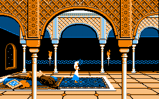
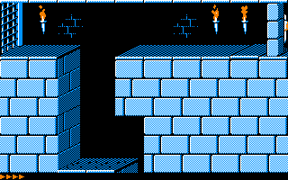

## Description

Prince of Persia enfin sur TO8 !

Le code 6502 de Jordan Mechner a été porté routine par routine en 6809, et comparé a l'exécution à la version Apple II. Les graphismes viennent de la version PC en 4 couleurs, le son passe par le CNA du TO8.

## L'éditeur de Mechner

En bonus, on a porté l'éditeur de niveaux de Mechner : une disquette pour le donjon, une pour le palais, avec leurs disquettes de données dans le ZIP.

Et en tapant P O P pendant une partie, ses touches de développement se réveillent.

## Jouer

Le jeu se joue au clavier:
J et L pour courir, I pour sauter, K pour se baisser, U et O pour sauter en avant, Espace pour l'épée.
La manette marche aussi, pad Mega Drive compris.

CNT-G sauvegarde la partie à partir du niveau 3, CNT-L sur l'écran titre la reprend.

Pas de TO8 sous la main ? Ça tourne aussi [dans le navigateur](/toje/?media=%2Freleases%2Fprince-of-persia%2Fprince-of-persia.fd&titre=Prince+of+Persia) avec TOJE.

***Aucune exploitation commerciale n'est autorisée.***

    
    

---

Credit spécial pour Jordan Mechner et ses planches de rotoscopie « Run-Jump » en banner :
<https://www.jordanmechner.com/en/artworks/run-jump/>


