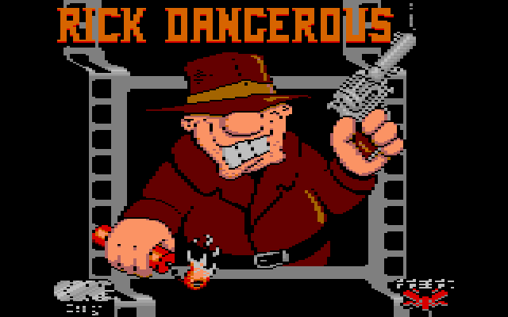
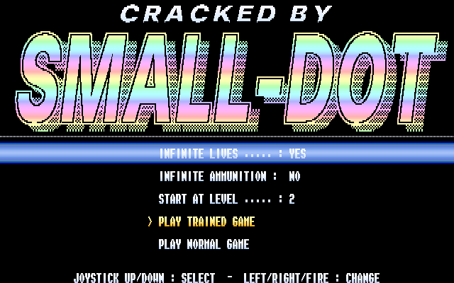
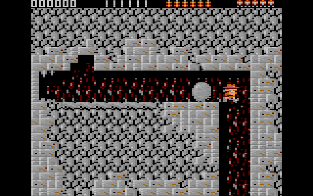
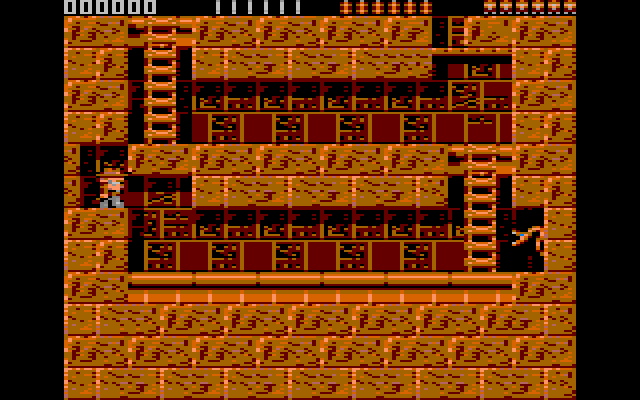
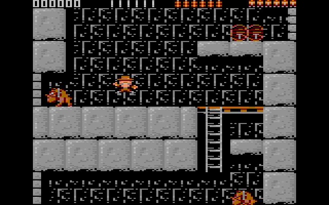
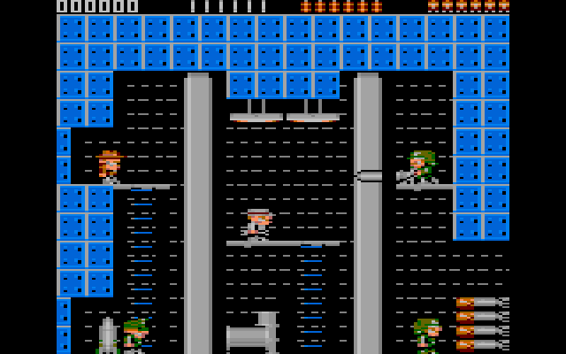

## Description

Rick Dangerous débarque sur TO8, le jeu complet cette fois !

Il s'agit d'une conversion de la version **Atari ST** : les quatre niveaux s'enchaînent (Amérique du Sud, Égypte, château de Schwarzendumpf, base de missiles), chacun précédé de son écran de mission. Les pièges, les ennemis et les rochers sont là, tout comme la musique et les bruitages du ST, avec les vrais échantillons pour le tir, les explosions et le cri de Rick.

Le jeu garde aussi le Hall of Fame, la saisie du nom en fin de partie… et l'œuf de Pâques du ST : entrez **POOKY** au tableau des scores pour choisir son niveau au départ de la partie suivante.

## Jouer

Le jeu se joue à la manette :

- Gauche / droite : marcher. Haut / bas : sauter, monter et descendre les échelles, ramper.
- Bouton + haut : tirer.
- Bouton + bas : poser une dynamite.
- Bouton + gauche / droite : frapper avec le bâton.

Pas de TO8 sous la main ? Ça tourne aussi [dans le navigateur](/toje/?media=%2Freleases%2Frick-dangerous%2Frick-dangerous.fd&titre=Rick+Dangerous) avec [TOJE](toje-web.html).

## Triches

Appuyez sur le bouton à l'écran-titre : la cracktro **SMALL-DOT** s'ouvre sur *PLAY NORMAL GAME*, un second appui lance une partie normale.

Pour tricher, montez dans le menu : vies illimitées, munitions illimitées et niveau de départ, puis *PLAY TRAINED GAME*. Haut / bas pour choisir une ligne, gauche / droite ou bouton pour changer la valeur. Une partie avec triches ne donne pas le bonus de fin.

***Aucune exploitation commerciale n'est autorisée.***

    
    
    
    
    
    

La [démo de scrolling](rick-scrolling-demo.html) de 2023, première étape sur ce thème, reste disponible.
