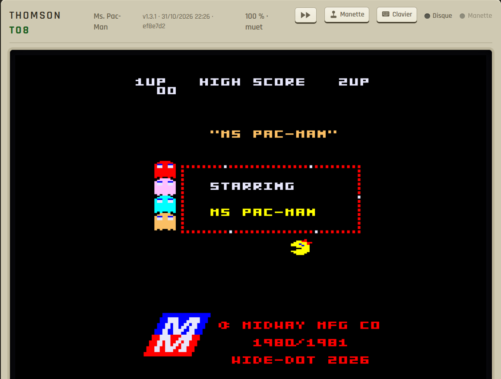

TOJE est l'émulateur Thomson TO8 que nous utilisons pour développer et tester nos jeux en assembleur 6809. Sa version web, **TOJE Web**, fait tourner la même machine dans une page, sans rien installer : le cœur d'émulation est écrit en Java et compilé en WebAssembly.

<figure class="toje-figure">
	
	<figcaption>TOJE Web, ici avec Ms. Pac-Man lancé par un lien direct.</figcaption>
</figure>

## Un émulateur TO8 écrit en Java

TOJE est un émulateur **Thomson TO8** écrit en Java 21. Nous l'avons développé pour disposer d'un émulateur multiplateforme dont nous maîtrisons entièrement le code source, afin d'y ajouter tous les outils de débogage nécessaires à nos phases de développement.

Le projet suit une architecture hexagonale stricte : le **domaine** ne dépend d'aucune bibliothèque d'infrastructure. Il contient l'émulation complète du processeur MC6809, de la mémoire et de sa pagination, du gate array vidéo, du son, des entrées-sorties et des médias. Autour, des adaptateurs apportent le rendu, l'audio, les manettes et le débogage : libGDX et Swing pour le bureau, une page HTML pour le web.

Le cœur est aussi l'outil de développement de l'équipe : la version bureau, pour le moment non diffusée, expose un serveur MCP de 88 outils (points d'arrêt qualifiés par page mémoire, profileur au cycle, trace matérielle, rembobinage, captures sans perte) grâce auquel un agent pilote la machine.

## De Java au WebAssembly

Pour que les rétrogamers et les rétrocodeurs puissent essayer nos productions facilement, nous en avons fait une déclinaison simplifiée et publique, exécutable dans le navigateur.

La version web ne réécrit rien : elle compile le code Java du **domaine, inchangé**, avec TeaVM vers **WebAssembly GC**. Le module produit pèse environ 1,4 Mo, ROMs du TO8 comprises, et une page HTML l'entoure : c'est elle qui gère le canvas, le son, les manettes, les fichiers et le stockage du navigateur.

Le dialogue entre les deux est minimal. La page demande une trame, le module rend une image et 882 échantillons audio, de quoi tenir le 50 Hz du TO8. Tout se passe **côté visiteur** : aucun serveur n'émule quoi que ce soit, les médias sont téléchargés depuis le site (ou ouverts depuis le disque) et les parties sauvegardées restent dans le navigateur.

Il faut pour cela un navigateur récent, avec Wasm GC : **Chrome 119+, Firefox 120+, Safari 18.2+**.

## Ce qui est supporté

- **Médias** : disquettes `.fd` et `.sap` sur deux lecteurs (changement à chaud, démarrage sur l'une ou l'autre), cartes SDDrive `.sd` avec le firmware réel, cartouches `.rom` et MegaROM.
- **Son** : le buzzer du TO8, plus les cartes d'extension SN76489, YM2413 et la synthèse vocale MEA8000.
- **Entrées** : clavier positionnel AZERTY traduit vers la matrice du TO8, deux manettes sur leurs ports, souris Thomson à deux boutons, commandes tactiles, clavier du TO8 à l'écran et clavier du téléphone.
- **Affichage** : proportions exactes du pixel TO8 (59:64), lissage par couverture en WebGL, mode « pixels nets », écran cathodique et plein écran.
- **Parties** : une sauvegarde automatique chaque minute et trois emplacements manuels, dans le navigateur, avec vignette. Reprendre remonte les médias puis l'état complet de la machine.
- **Mes disquettes** : copies de travail inscriptibles et disquettes vierges, conservées dans le navigateur et téléchargeables en `.fd`. Les originaux restent protégés et intacts.
- **Confort** : chargements rapides, accélération en maintenant `F7`, voyant d'activité du lecteur, capture PNG et liens directs `?media=…&titre=…`.

Le tout fonctionne aussi **hors ligne** : une fois la page chargée, un service worker garde le module et les médias déjà joués.

## Ce que TOJE Web n'est pas

- **TO8 uniquement.** TOJE émule le TO8, pas toute la gamme Thomson : ni MO5, ni TO9, ni TO9+.
- **Pas d'outillage de débogage.** Les points d'arrêt, le profileur et la trace restent dans la version bureau non disponible publiquement : le navigateur est fait pour jouer.

## Lancer

Chaque page de jeu porte un bouton **Jouer dans le navigateur**. Pour partir de zéro, ouvrez directement l'émulateur et glissez-y une disquette.

<a href="/toje/" class="button primary">Lancer TOJE Web</a>

