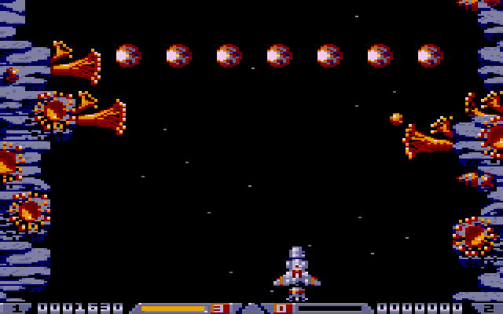
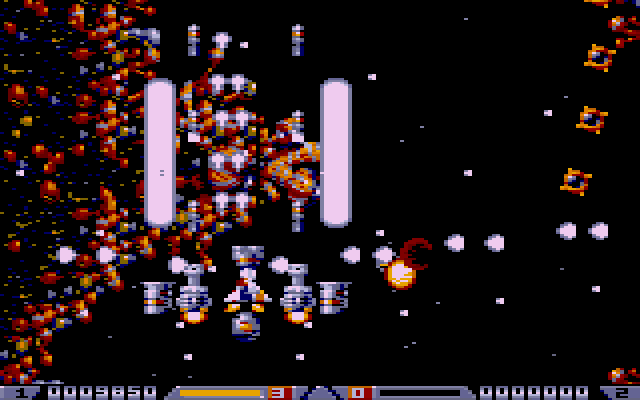
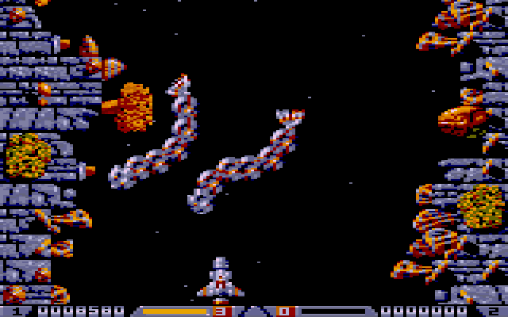
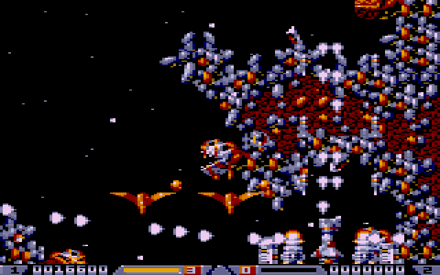
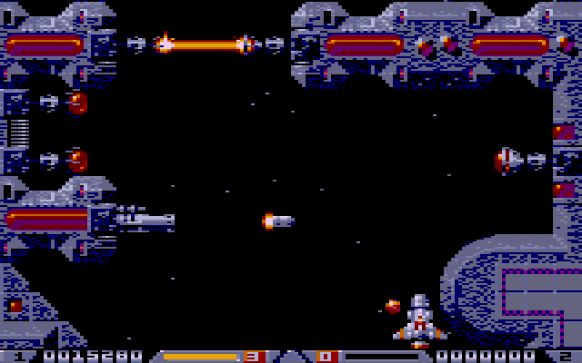
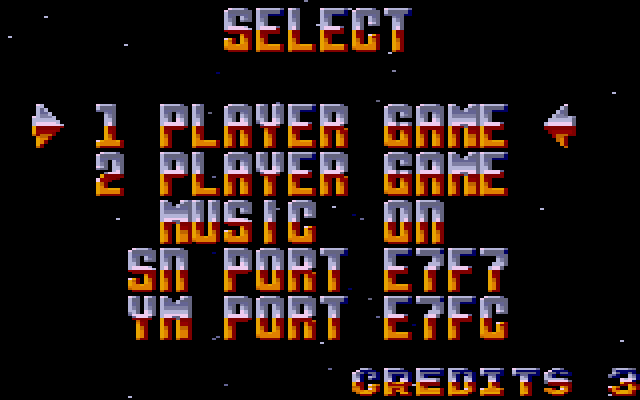
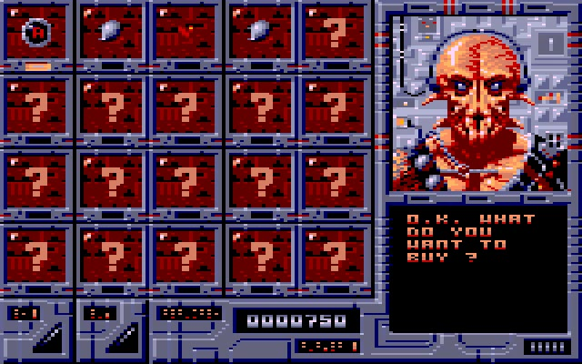

## Description

Le shoot-them-up vertical des Bitmap Brothers, quelle est donc cette diablerie ?

Il s'agit d'une conversion de la version **Atari ST**, en assembleur 6809, sur le moteur de jeu wide-dot. Les graphismes, les décors et les trajectoires des ennemis viennent du ST : ils ont été relevés sur l'original puis comparés au pixel près avec la version TO8.

Le jeu est **en cours de développement** : il n'est pas encore téléchargeable.

    
    
    
    
    
    
    

## Ce qui est porté

- **Les cinq niveaux** et leur scrolling vertical en 16 couleurs, avec le décor qui peut **revenir en arrière**, comme dans l'original : les ennemis du décor déjà passés réapparaissent quand le scroll recule.
- **Les vagues d'ennemis**, les ennemis du décor (canons, tourelles, organes, pinces…), les **mini-boss** de mi-niveau et les **boss** de fin.
- **Le Megablaster** et son armement : tirs latéraux et arrière, lasers, missiles, têtes chercheuses, mines, Electro Ball, Dive, bonus, jusqu'à la panoplie du **Super Nashwan**.
- **La boutique de Colin**, au milieu et à la fin de chaque niveau, pour vendre et acheter armes, bonus et réparations. Il parle, il cligne des yeux, et il vous salue.
- **Le mode 2 joueurs** en alternance : chacun sa partie, son score et ses vies, avec HIGH SCORE, CONTINUE et GAME OVER par joueur.
- **La musique Megablast** sur les cartes son SN76489 et YM2413, avec un menu **SELECT** pour choisir le nombre de joueurs, couper la musique et régler les ports des cartes son.
- La fin de partie, puis **le tour suivant**, plus difficile.

## Triches

Sur l'écran d'accueil, poussez la manette dans une direction, sans appuyer sur le bouton : la cracktro **SMALL-DOT** s'affiche, avec son trainer +5.

- Haut / bas : choisir une ligne.
- Gauche / droite ou bouton : changer la valeur.
- Bouton sur *BACK TO THE TITLE* : retour à l'écran d'accueil.

Au choix : **INVINCIBILITY** (invincibilité), **MAXIMUM WEAPONS** (toutes les armes au maximum), **INFINITE LIVES** (vies infinies), **STARTING LEVEL** (niveau de départ) et **COLIN'S SHOP** (partir de la boutique, avec de quoi dépenser). Elles restent actives après un GAME OVER.

## État du projet

Le jeu est jouable du premier au dernier niveau. Il est **en cours de finalisation** (réglages, optimisations, derniers détails de fidélité à la version ST) et n'est pas encore téléchargeable.

***Aucune exploitation commerciale n'est autorisée.***
