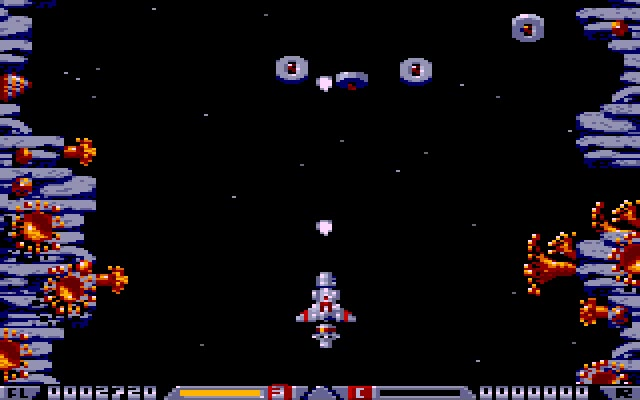
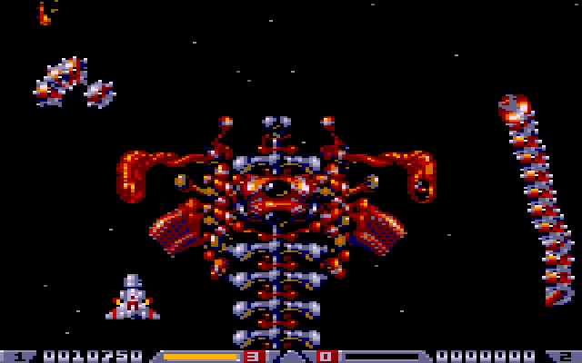
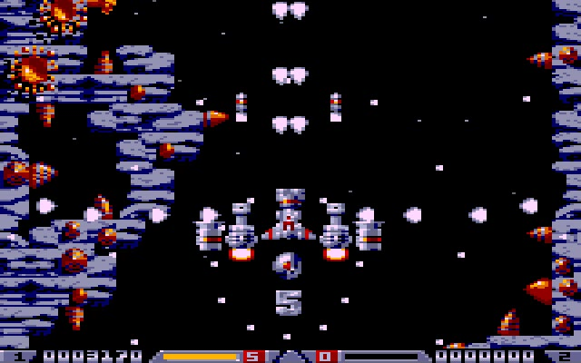
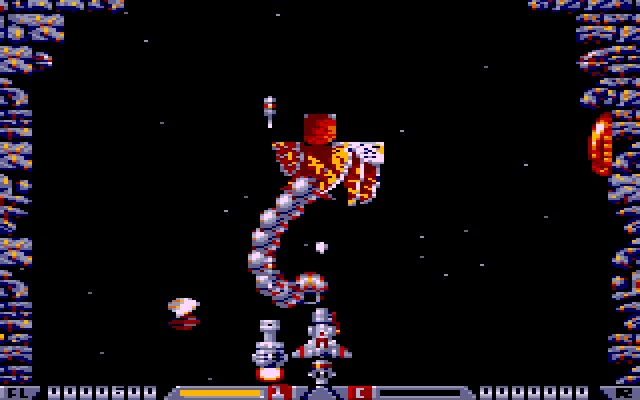
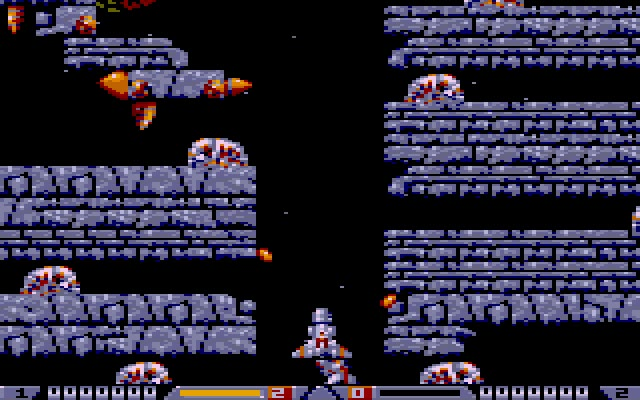

## Description

Le shoot-them-up vertical des Bitmap Brothers débarque sur TO8 !

Il s'agit d'une conversion de la version **Atari ST** : les cinq niveaux, leurs vagues d'ennemis, leurs mini-boss et leurs boss de fin, avec le décor qui défile et qui peut aussi revenir en arrière, comme dans l'original. Les trajectoires des ennemis ont été relevées sur le ST et comparées au pixel près avec la version TO8.

Et bien sûr, **Colin** est là : sa boutique s'ouvre au milieu et à la fin de chaque niveau pour vendre et acheter armes, bonus et réparations. Il parle, il cligne des yeux, et il vous salue.

## Réseau de neurones

Comme pour Ms. Pac-Man, un réseau de neurones a appris à jouer au jeu. Il a été entraîné par algorithme génétique, en faisant tourner des milliers de parties dans [TOJE](toje-web.html) sans affichage, bien plus vite que le temps réel.

## État du projet

Le jeu est jouable du premier au dernier niveau, jusqu'à la fin de partie et au tour suivant, plus difficile. Il est en cours de finalisation et n'est pas encore téléchargeable.

***Aucune exploitation commerciale n'est autorisée.***

    
    
    
    
    
    

